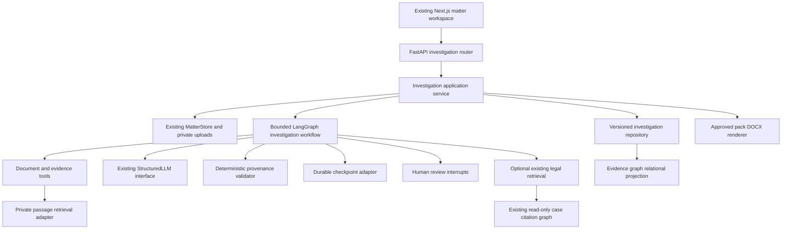

# LexTrace Investigations — V1 Architecture

Status: proposed; repository evidence inspected on 2026-11-05. This supplements [the existing architecture](../architecture.md) without changing its implemented contracts. Product requirements are in [PRODUCT_SPEC.md](PRODUCT_SPEC.md).

## Existing system and reuse assessment

| Area and inspected implementation | Existing behavior | V1 disposition |
| --- | --- | --- |
| `api/app.py`, `cli.py` | FastAPI search/cases/research/matter/monitoring endpoints; bounded background executors; CLI tools | Preserve routes and CLI; add an investigation router with thin handlers rather than growing the application module |
| `domain/case.py`, ingestion and corpus modules | Canonical Case/Opinion corpus, CourtListener schemas, validated ingestion | Reuse unchanged for legal authority; never store private evidence as Case records |
| `matter/contracts.py`, `matter/store.py` | Matter, document, section, fact, legal claim, citation and authority records; SQLite JSON payload tables and private files | Reuse Matter/document IDs and upload boundary; add versioned investigation tables through explicit migrations and a focused repository |
| `matter/documents.py` | Bounded PDF/DOCX/TXT/Markdown extraction, exact extracted-text spans, hash deduplication, OCR_REQUIRED | Reuse parsers; add immutable extraction manifests, coverage and version-aware references |
| `matter/analysis.py` | Bounded legal issue/claim extraction, citation resolution, authority analysis | Preserve Argument X-Ray; use its structured-output and quote-validation patterns, not its legal-claim schema, for factual extraction |
| `retrieval/engine.py`, `bm25.py`, `dense.py`, `fusion.py`, `models.py`, `index.py`, `passages.py` | BM25, dense, RRF, cross-encoder and optional citation expansion; exact passages, filtered candidates, identity checks | Keep public engine; share ranking primitives through adapters for private passages |
| `research/workflow.py`, `llm.py`, `prompts.py`, `observability.py` | 13-node LangGraph legal-research workflow; structured generation, bounded revision, run-local verification, safe traces | Reuse LLM protocol, prompt versioning and tracing; extract narrowly shared provenance helpers only with parity tests |
| `research/runtime.py` | SQLite run/result/trace storage, structured-call cache and in-process executor | Reuse patterns; current resume reruns a failed/degraded stored request, not a persisted graph checkpoint |
| `matter/workflows.py`, `deep_research.py`, `red_team.py` | LangGraph research plan approval check, bounded searches, attack hypotheses, factual comparisons and attack verification | Reuse bounded-tool and verification patterns; legal counter-authority attacks are not a factual inconsistency model |
| `graph/contracts.py`, `build.py`, `store.py`, `intelligence.py` | Immutable case citation graph, opinion provenance, indexed bounded traversal, separate derived treatment/doctrine analysis | Preserve unchanged; no evidence nodes/edges or new authority scores in this store |
| `matter/matrix.py`, monitoring modules | Evidence matrix/CSV, review and invalidation patterns, local case monitoring | Preserve; do not repurpose legal matrix rows as a chronology or CSV exporter as a DOCX renderer |
| `frontend/app`, `MatterWorkspace.tsx`, panels and `frontend/lib` | Next.js/React matter/research/search UI, upload, polling, highlighted sources, claim edits, research/monitoring panels | Extend existing routes with focused investigation components; avoid replacing the workspace or adding frontend infrastructure |
| Tests in `tests/unit`, `tests/api`, `tests/integration`, frontend component tests | Document safety/offsets, matter lifecycle/manual edits, retrieval identity/filters, grounding/revision, research plans, graph and monitoring behavior | Preserve as regression surface; add synthetic investigation fixtures and restart/review/export tests |

Dependencies already include Pydantic, FastAPI, pypdf, multipart, NumPy, and optional LangGraph/structured LLM providers. DOCX input parsing exists, but a deposition DOCX writer and durable LangGraph saver integration are new work. No dependency was installed for this design. Existing architecture prose contains historical placeholder descriptions; current source is the basis for this inventory.

## Component boundaries

Proposed package `src/lextrace/investigations/` owns contracts, extraction, chronology, inconsistencies, evidence retrieval, repositories, tools, graph workflow, review and pack services. It references existing matter contracts, not the reverse. Use `api/investigations.py` for new routes. Keep algorithms independent of LangGraph and HTTP. Avoid a generalized agent platform or a wholesale MatterStore rewrite.

## Core records and invariants

New records follow Pydantic `Record` conventions with forbidden extra fields and explicit validators. All matter-owned records include `matter_id`; generated records include `run_id`, schema version, revision, created time and generator identity. IDs are opaque server-issued identifiers. References resolve through matter-scoped repositories; schema validation alone cannot enforce ownership.

| Record | Required information and rules |
| --- | --- |
| `DocumentVersion` | document/matter IDs, immutable original content hash, extracted-text hash, parser/version/settings identity, text length, page starts, extraction warnings and coverage; version ID changes with representation |
| `EvidenceReference` | matter/document/version/section IDs, half-open Python Unicode character offsets `[start,end)` into the full extracted text, exact quote, optional page range; bounds, quote equality and section containment must validate |
| `Entity` / `EntityMention` | person/organization/other, canonical label, aliases and source-backed mentions; uncertain matches remain distinct until reviewed; merge history is explicit |
| `FactAssertion` | normalized proposition, exact supporting references, attributed speaker/author when known, subject/predicate/object or text fallback, polarity, modality, stated time, verification and review states; preserves source allegation versus truth distinction |
| `Event` | description, participant entity IDs/roles, fact IDs, source references, `TemporalExpression`, uncertainty and review state; distinct accounts need not collapse to one event |
| `TemporalExpression` | raw date expression and evidence, optional earliest/latest date or timestamp, precision, timezone if supplied, interpretation basis; ordered bounds; unknown/relative unresolved dates stay unknown |
| `ChronologySnapshot` | immutable event revision list, deterministic ordering policy, excluded/undated IDs, coverage manifest, input digest and review digest; unknown dates separate, overlapping intervals explicitly ambiguous |
| `InconsistencyFinding` | two or more distinct assertion revisions and evidence sets, category (date/account/identity/quantity), comparison scope, explanation, compatible alternatives, proposed follow-ups, provenance state and reviewer decision; cannot assert dishonesty |
| `EvidenceEdge` | matter-scoped typed endpoints/revisions and relation (MENTIONS, PARTICIPATED_IN, SUPPORTED_BY, POTENTIALLY_INCONSISTENT_WITH), source/finding provenance, run and review state; no unverified edge enters the approved projection |
| `ReviewDecision` | target type/ID/revision, decision ACCEPT/REJECT/DEFER/EDIT, reviewer ID, time, rationale, expected revision and replacement revision if edited; append-only, optimistic concurrency |
| `InvestigationRun` | input snapshot/digest, document versions, workflow/prompt/model/index identities, budgets, coverage, node outcomes, thread/checkpoint IDs, status, safe failure codes and cancellation flag |
| `InvestigationSnapshot` | approved entity/fact/event/finding revisions, chronology, evidence registry, exclusions and review decision digest; freezes inputs for a pack |
| `WitnessProfile` | selected entity or manual identity, approved aliases, scope/topics and source-backed role/background; identity ambiguity blocks witness-specific assertions |
| `DepositionPack` / `Question` | witness and snapshot revisions, source-linked narrative blocks, topics, questions/purposes/premise references, exhibit index and open items; pack revision, verification result and approval digest |
| `ExportArtifact` | pack revision/digest, source snapshot, renderer/template version, file hash, status and private artifact ID; atomic publication and idempotent reuse |

Verification states are separate from review states: e.g. VALID/INVALID/INSUFFICIENT versus PROPOSED/ACCEPTED/REJECTED/DEFERRED/STALE. Do not overload existing legal `VerificationStatus` to express factual truth. Existing `MatterFact` is an exact single-span excerpt and is not sufficient for these richer assertions. Existing `MatterEvidence` validates CourtListener URLs and remains an authority-only type.

Current section IDs hash content hash and offsets without document/matter ownership; new references must use a composite version/document/section key. Test identical content in different matters. Keep old IDs and data readable; address legacy collisions through a scoped additive migration before claiming global uniqueness. Browser highlighting must translate Python code-point offsets to JavaScript UTF-16 offsets, with a non-BMP regression test; direct `slice` is not a sufficient general offset contract.

## Persistence, evidence graph and retrieval

Retain the local SQLite/private-file architecture. Add numbered additive migrations, transactional revision/decision writes, indexes on matter/run/version/target, and a schema-version table. A focused investigation repository may share the existing matter database through explicit connection ownership; it must not reach into MatterStore private attributes. LangGraph checkpoint storage is separate from domain tables. New private text, indexes, checkpoints and exports live below ignored private matter runtime storage with current restrictive permissions, never in the public corpus/index/graph or version control. Extend deletion and active-run checks to remove all new private artifacts; historical records must not outlive deleted source content accidentally.

The evidence graph is a relational projection over entities, assertions, events, sources and reviewed findings. No graph database is required. Bounded indexed queries are enough for V1. It is independent of `CitationEdge`, reporter citations and public case traversal. Optional legal links use typed authority references across that boundary, never mixed edge semantics. Evidence graph edges do not assign authority, credibility or relevance scores.

Keep `LexTraceRetriever` and `RetrievalResult` unchanged for case law. Add `EvidenceSearchRequest/Result` for matter passages, versions, exact evidence references and diagnostics. Reuse tokenizer/BM25 mathematics, dense encoding, RRF and PairScorer through a small shared ranking core: current BM25 requires Case objects with positive numeric IDs, so a regression-protected adapter/refactor is required. Do not fabricate CourtListener IDs/URLs or introduce a second BM25 algorithm. Private passage IDs use deterministic document/version/offset ordering; public case ties remain numeric source-ID ties.

Enforce matter, approved input versions and requested metadata filters before candidate generation/ranking. Deduplicate passages; keep exact offsets across chunk overlap. Index identity includes input version hashes, lexical configuration, encoder/reranker revision, tokenizer, pooling, passage/window and preprocessing settings. Rebuild only affected private indexes. Legal authority search remains optional, uses existing temporal filters/citation expansion and returns the existing contract; only the cross-encoder assigns final relevance in citation_reranked mode.

## LangGraph design and tool permissions

Use one typed investigation graph with explicit specialist nodes, not autonomous agents with unrestricted tools. These are logical agent roles, not separate processes. State stores matter/run IDs, frozen input versions, artifact revision IDs, coverage, witness selection, budgets, errors, pending review token and approval digests; load bounded source text through tools rather than duplicating an entire corpus in checkpoints.

| Node / role | Tools and output | Boundary |
| --- | --- | --- |
| `validate_inputs` | matter-scoped read, extraction/version manifest | Reject wrong-matter or non-ready inputs; record exclusions |
| `extract_assertions` | bounded section reads, StructuredLLM | Candidate entities, attributed assertions, events and raw date expressions |
| `verify_extraction` | exact-span/ownership/hash checks | Quarantine invalid candidates; at most one repair; record coverage |
| `resolve_entities_and_time` | mention/date helpers, structured proposals | Preserve unresolved identities/dates; optional early review interrupt |
| `build_chronology` | deterministic interval ordering | Versioned chronology, unknown/ambiguous entries |
| `investigate_inconsistencies` | bounded evidence search and contextual reads | Candidate comparison pairs, alternatives, follow-up questions |
| `verify_findings` | independent deterministic provenance plus structured semantic assessment | Missing or incomparable evidence cannot become an exportable finding |
| `review_investigation` | persisted decision reads, human interrupt | Wait for approval of exact snapshot digest; rejection routes to targeted revision |
| `prepare_witness_pack` | approved snapshot reads, structured drafting; optional explicitly enabled legal search | Witness-focused draft and fully referenced question premises |
| `verify_pack` | document and authority reference validation; semantic assessment | One bounded repair, then reviewable valid draft or blocked result |
| `review_pack` | human interrupt | Approval binds exact verified pack and snapshot digest |
| `publish_export` | deterministic DOCX rendering service | Recheck approval/provenance and atomically publish artifact |

Flow: validate → extract → verify → resolve → chronology → investigate → verify findings → investigation review → pack → pack verification → pack review → export. Invalid evidence routes to quarantine/repair, not automatic acceptance. Exhausted budgets yield PARTIAL and require explicit exclusion/coverage review before proceeding. Empty evidence yields a blocked preparation result, not invented background. Cancellation is checked between bounded tasks and before publication; late results cannot promote a canceled run.

Tools are application services with allowlisted arguments and server-selected storage paths. No arbitrary SQL, shell, network browsing or file paths are exposed to nodes. Treat uploaded text as untrusted evidence, never instructions. Prompts, context caches and outputs are private and matter-scoped; reuse the existing structured-call cache only with matter/version/schema/workflow identities and deletion coverage.

## Checkpointing, review and recovery

Compile the new graph with a durable saver behind an injected checkpoint protocol; use an in-memory implementation in unit tests. A local SQLite LangGraph saver is the proposed integration, subject to dependency/API verification during its milestone. Do not pretend existing RunStore is a saver. Do not change existing research resume semantics.

Each investigation has a server-generated thread ID bound to matter/run/input digest. Save after successful node boundaries and at human interrupts. Review APIs validate ownership, expected revision, pending interrupt ID and approval digest before typed resume. Never accept client-supplied arbitrary graph state or a bare `approved=true`. Record decisions durably before scheduling continuation; recover via a resume intent/outbox and idempotency key if a process dies between decision commit and checkpoint advancement. Replay may re-enter a node: put non-repeatable side effects behind idempotent services and keep review interrupt nodes free of preceding writes.

Domain DB and checkpoint DB are not one atomic transaction. Artifact writes use deterministic operation IDs, transactional upserts and a reconciliation record; publish files with temporary-write/rename and register only complete artifacts. Crash recovery reconciles queued/running jobs and outstanding resume intents. One bounded local worker claims a run with a lease; concurrent resumes conflict safely. No distributed queue is needed in V1.

Review changes create new revisions, invalidate dependent snapshots/packs by dependency IDs and input digests, and require the relevant gate again. Never mutate frozen prior runs. Run states: QUEUED, RUNNING, WAITING_REVIEW, PARTIAL, COMPLETED, FAILED, CANCELED. Export availability is a separate artifact state; COMPLETED alone does not authorize export.

## Proposed API and frontend contract

Preserve existing matter/document endpoints. Add matter-scoped routes for investigation runs (create/get/cancel), run chronology/entities/assertions/findings, review decisions and explicit resume, witnesses, pack generation/revisions, pack approval, export creation/status/download. Return 202 plus run/artifact ID for background operations, 409 for stale revisions or duplicate active transitions, and safe validation/not-found errors without private text. Reads, resume and downloads verify matter ownership. The exact route names are finalized in the API milestone.

Continue existing polling and shared API helpers; split the existing large MatterWorkspace only as needed for new panels. Add no new UI framework. Make source navigation, keyboard review, side-by-side evidence, partial coverage and pending-review status visible. Export is available only for an approved verified revision.

## Verification and operational limits

Use deterministic fake encoders, rerankers, LLMs, clocks and IDs; HTTPX MockTransport for external HTTP tests. Existing unit/API/integration and frontend component suites remain regression gates. Add adversarial provenance, cross-matter isolation, Unicode offsets, temporal ambiguity, checkpoint restart/replay, stale approvals and export validation tests. A synthetic integration fixture tests the entire review flow; independent reviewed examples evaluate semantic usefulness rather than equating quote validation with accuracy.

Safe telemetry contains IDs, counts, hashes, versions, durations, budgets and error codes; exclude private filenames, source text, questions, prompts, credentials and hidden reasoning. Explicit provider configuration is required before private content leaves the host. This design is a local pilot, not a claim of production confidentiality or multi-user readiness.

### M4B/M4C implementation boundary

`investigations/review.py` records strict UTC-attributed decisions and immutable
review revisions over original events, assertions and entity mentions. ACCEPT,
REJECT and DEFER use the existing `ReviewState`; EDIT resets acceptance to
PROPOSED. Every command names the full matter/document/version/run/record identity
and expected review revision. Date interpretations and explicit mention-to-entity
links remain separate from original extraction output. Resolving multiple mentions
to the same reviewer-supplied canonical ID is an explicit identity merge; it never
merges events or infers that a witness has personal knowledge. Acceptance does not
change provenance verification, source attribution or factual truth.

Migration 3 adds review revision and decision journals, active/retired source
identities, and immutable projection dependency manifests. Repository transactions
use BEGIN IMMEDIATE for compare-and-append across independent connections. Equal
command replays return the original result, even after later decisions; conflicting
identity reuse fails. Audit payloads survive source deletion. Live reads require
current matter/document ownership and an active immutable version. Newly inserted
versions supersede prior representations; replaying an existing version cannot
reactivate it. A deletion trigger retires source identities, preventing accidental
resurrection if a document ID is reused. On migration, only a sole existing version
is activated automatically; ambiguous historical versions fail closed until a new
representation is explicitly registered.

`reviewed_chronology.py` projects review revisions using the M4A inclusive overlap
policy, preserves unknown dates and excluded decisions, and orders on corrected
interpretations without modifying source temporal records. Persist a
`ProjectionDependency` containing the exact event revisions to reconstruct it via
`load_reviewed_chronology`. Currency is derived transactionally from exact input
revisions and live source identities, rather than mutating historical snapshots or
caching an accepted flag. Changing an input invalidates only manifests that name
it. Future M6/M7/M9/M10 services must supply a flattened transitive list of all
upstream assertion/event/mention revisions, including identity links, and recheck
currency and provenance at publication. They must request accepted inputs for
publication; a current reviewable chronology can contain proposed records. No
workflow, finding, pack, export, or approval-token implementation is included here.
