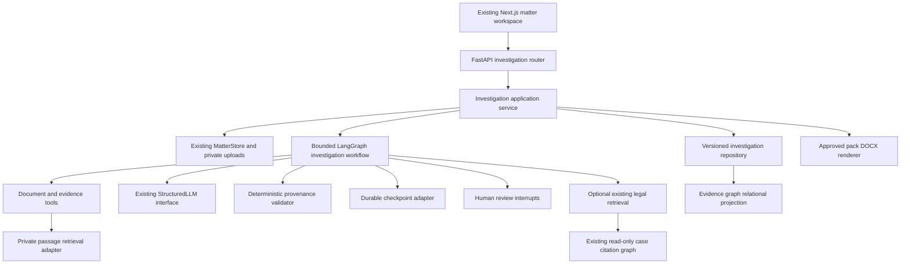

# LexTrace Investigations — V1 Architecture

Status: proposed; repository evidence inspected on 2026-11-05. This supplements [the existing architecture](../architecture.md) without changing its implemented contracts. Product requirements are in [PRODUCT_SPEC.md](PRODUCT_SPEC.md).

## Existing system and reuse assessment

| Area and inspected implementation | Existing behavior | V1 disposition |
| --- | --- | --- |
| `api/app.py`, `cli.py` | FastAPI search/cases/research/matter/monitoring endpoints; bounded background executors; CLI tools | Preserve routes and CLI; add an investigation router with thin handlers rather than growing the application module |
| `domain/case.py`, ingestion and corpus modules | Canonical Case/Opinion corpus, CourtListener schemas, validated ingestion | Reuse unchanged for legal authority; never store private evidence as Case records |
| `matter/contracts.py`, `matter/store.py` | Matter, document, section, fact, legal claim, citation and authority records; SQLite JSON payload tables and private files | Reuse Matter/document IDs and upload boundary; add versioned investigation tables through explicit migrations and a focused repository |
| `matter/documents.py` | Bounded PDF/DOCX/TXT/Markdown extraction, exact extracted-text spans, hash deduplication, OCR_REQUIRED | Reuse parsers; add immutable extraction manifests, coverage and version-aware references |
| `matter/analysis.py` | Bounded legal issue/claim extraction, citation resolution, authority analysis | Preserve Argument X-Ray; use its structured-output and quote-validation patterns, not its legal-claim schema, for factual extraction |
| `retrieval/engine.py`, `bm25.py`, `dense.py`, `fusion.py`, `models.py`, `index.py`, `passages.py` | BM25, dense, RRF, cross-encoder and optional citation expansion; exact passages, filtered candidates, identity checks | Keep public engine; share ranking primitives through adapters for private passages |
| `research/workflow.py`, `llm.py`, `prompts.py`, `observability.py` | 13-node LangGraph legal-research workflow; structured generation, bounded revision, run-local verification, safe traces | Reuse LLM protocol, prompt versioning and tracing; extract narrowly shared provenance helpers only with parity tests |
| `research/runtime.py` | SQLite run/result/trace storage, structured-call cache and in-process executor | Reuse patterns; current resume reruns a failed/degraded stored request, not a persisted graph checkpoint |
| `matter/workflows.py`, `deep_research.py`, `red_team.py` | LangGraph research plan approval check, bounded searches, attack hypotheses, factual comparisons and attack verification | Reuse bounded-tool and verification patterns; legal counter-authority attacks are not a factual inconsistency model |
| `graph/contracts.py`, `build.py`, `store.py`, `intelligence.py` | Immutable case citation graph, opinion provenance, indexed bounded traversal, separate derived treatment/doctrine analysis | Preserve unchanged; no evidence nodes/edges or new authority scores in this store |
| `matter/matrix.py`, monitoring modules | Evidence matrix/CSV, review and invalidation patterns, local case monitoring | Preserve; do not repurpose legal matrix rows as a chronology or CSV exporter as a DOCX renderer |
| `frontend/app`, `MatterWorkspace.tsx`, panels and `frontend/lib` | Next.js/React matter/research/search UI, upload, polling, highlighted sources, claim edits, research/monitoring panels | Extend existing routes with focused investigation components; avoid replacing the workspace or adding frontend infrastructure |
| Tests in `tests/unit`, `tests/api`, `tests/integration`, frontend component tests | Document safety/offsets, matter lifecycle/manual edits, retrieval identity/filters, grounding/revision, research plans, graph and monitoring behavior | Preserve as regression surface; add synthetic investigation fixtures and restart/review/export tests |

Dependencies already include Pydantic, FastAPI, pypdf, multipart, NumPy, and optional LangGraph/structured LLM providers. DOCX input parsing exists, but a deposition DOCX writer and durable LangGraph saver integration are new work. No dependency was installed for this design. Existing architecture prose contains historical placeholder descriptions; current source is the basis for this inventory.

## Component boundaries

Proposed package `src/lextrace/investigations/` owns contracts, extraction, chronology, inconsistencies, evidence retrieval, repositories, tools, graph workflow, review and pack services. It references existing matter contracts, not the reverse. Use `api/investigations.py` for new routes. Keep algorithms independent of LangGraph and HTTP. Avoid a generalized agent platform or a wholesale MatterStore rewrite.

## Core records and invariants

New records follow Pydantic `Record` conventions with forbidden extra fields and explicit validators. All matter-owned records include `matter_id`; generated records include `run_id`, schema version, revision, created time and generator identity. IDs are opaque server-issued identifiers. References resolve through matter-scoped repositories; schema validation alone cannot enforce ownership.

| Record | Required information and rules |
| --- | --- |
| `DocumentVersion` | document/matter IDs, immutable original content hash, extracted-text hash, parser/version/settings identity, text length, page starts, extraction warnings and coverage; version ID changes with representation |
| `EvidenceReference` | matter/document/version/section IDs, half-open Python Unicode character offsets `[start,end)` into the full extracted text, exact quote, optional page range; bounds, quote equality and section containment must validate |
| `Entity` / `EntityMention` | person/organization/other, canonical label, aliases and source-backed mentions; uncertain matches remain distinct until reviewed; merge history is explicit |
| `FactAssertion` | normalized proposition, exact supporting references, attributed speaker/author when known, subject/predicate/object or text fallback, polarity, modality, stated time, verification and review states; preserves source allegation versus truth distinction |
| `Event` | description, participant entity IDs/roles, fact IDs, source references, `TemporalExpression`, uncertainty and review state; distinct accounts need not collapse to one event |
| `TemporalExpression` | raw date expression and evidence, optional earliest/latest date or timestamp, precision, timezone if supplied, interpretation basis; ordered bounds; unknown/relative unresolved dates stay unknown |
| `ChronologySnapshot` | immutable event revision list, deterministic ordering policy, excluded/undated IDs, coverage manifest, input digest and review digest; unknown dates separate, overlapping intervals explicitly ambiguous |
| `InconsistencyFinding` | two or more distinct assertion revisions and evidence sets, category (date/account/identity/quantity), comparison scope, explanation, compatible alternatives, proposed follow-ups, provenance state and reviewer decision; cannot assert dishonesty |
| `EvidenceEdge` | matter-scoped typed endpoints/revisions and relation (MENTIONS, PARTICIPATED_IN, SUPPORTED_BY, POTENTIALLY_INCONSISTENT_WITH), source/finding provenance, run and review state; no unverified edge enters the approved projection |
| `ReviewDecision` | target type/ID/revision, decision ACCEPT/REJECT/DEFER/EDIT, reviewer ID, time, rationale, expected revision and replacement revision if edited; append-only, optimistic concurrency |
| `InvestigationRun` | input snapshot/digest, document versions, workflow/prompt/model/index identities, budgets, coverage, node outcomes, thread/checkpoint IDs, status, safe failure codes and cancellation flag |
| `InvestigationSnapshot` | approved entity/fact/event/finding revisions, chronology, evidence registry, exclusions and review decision digest; freezes inputs for a pack |
| `WitnessProfile` | selected entity or manual identity, approved aliases, scope/topics and source-backed role/background; identity ambiguity blocks witness-specific assertions |
| `DepositionPack` / `Question` | witness and snapshot revisions, source-linked narrative blocks, topics, questions/purposes/premise references, exhibit index and open items; pack revision, verification result and approval digest |
| `ExportArtifact` | pack revision/digest, source snapshot, renderer/template version, file hash, status and private artifact ID; atomic publication and idempotent reuse |

Verification states are separate from review states: e.g. VALID/INVALID/INSUFFICIENT versus PROPOSED/ACCEPTED/REJECTED/DEFERRED/STALE. Do not overload existing legal `VerificationStatus` to express factual truth. Existing `MatterFact` is an exact single-span excerpt and is not sufficient for these richer assertions. Existing `MatterEvidence` validates CourtListener URLs and remains an authority-only type.

Current section IDs hash content hash and offsets without document/matter ownership; new references must use a composite version/document/section key. Test identical content in different matters. Keep old IDs and data readable; address legacy collisions through a scoped additive migration before claiming global uniqueness. Browser highlighting must translate Python code-point offsets to JavaScript UTF-16 offsets, with a non-BMP regression test; direct `slice` is not a sufficient general offset contract.

## Persistence, evidence graph and retrieval

Retain the local SQLite/private-file architecture. Add numbered additive migrations, transactional revision/decision writes, indexes on matter/run/version/target, and a schema-version table. A focused investigation repository may share the existing matter database through explicit connection ownership; it must not reach into MatterStore private attributes. LangGraph checkpoint storage is separate from domain tables. New private text, indexes, checkpoints and exports live below ignored private matter runtime storage with current restrictive permissions, never in the public corpus/index/graph or version control. Extend deletion and active-run checks to remove all new private artifacts; historical records must not outlive deleted source content accidentally.

The evidence graph is a relational projection over entities, assertions, events, sources and reviewed findings. No graph database is required. Bounded indexed queries are enough for V1. It is independent of `CitationEdge`, reporter citations and public case traversal. Optional legal links use typed authority references across that boundary, never mixed edge semantics. Evidence graph edges do not assign authority, credibility or relevance scores.

Keep `LexTraceRetriever` and `RetrievalResult` unchanged for case law. Add `EvidenceSearchRequest/Result` for matter passages, versions, exact evidence references and diagnostics. Reuse tokenizer/BM25 mathematics, dense encoding, RRF and PairScorer through a small shared ranking core: current BM25 requires Case objects with positive numeric IDs, so a regression-protected adapter/refactor is required. Do not fabricate CourtListener IDs/URLs or introduce a second BM25 algorithm. Private passage IDs use deterministic document/version/offset ordering; public case ties remain numeric source-ID ties.

Enforce matter, approved input versions and requested metadata filters before candidate generation/ranking. Deduplicate passages; keep exact offsets across chunk overlap. Index identity includes input version hashes, lexical configuration, encoder/reranker revision, tokenizer, pooling, passage/window and preprocessing settings. Rebuild only affected private indexes. Legal authority search remains optional, uses existing temporal filters/citation expansion and returns the existing contract; only the cross-encoder assigns final relevance in citation_reranked mode.

## LangGraph design and tool permissions

Use one typed investigation graph with explicit specialist nodes, not autonomous agents with unrestricted tools. These are logical agent roles, not separate processes. State stores matter/run IDs, frozen input versions, artifact revision IDs, coverage, witness selection, budgets, errors, pending review token and approval digests; load bounded source text through tools rather than duplicating an entire corpus in checkpoints.

| Node / role | Tools and output | Boundary |
| --- | --- | --- |
| `validate_inputs` | matter-scoped read, extraction/version manifest | Reject wrong-matter or non-ready inputs; record exclusions |
| `extract_assertions` | bounded section reads, StructuredLLM | Candidate entities, attributed assertions, events and raw date expressions |
| `verify_extraction` | exact-span/ownership/hash checks | Quarantine invalid candidates; at most one repair; record coverage |
| `resolve_entities_and_time` | mention/date helpers, structured proposals | Preserve unresolved identities/dates; optional early review interrupt |
| `build_chronology` | deterministic interval ordering | Versioned chronology, unknown/ambiguous entries |
| `investigate_inconsistencies` | bounded evidence search and contextual reads | Candidate comparison pairs, alternatives, follow-up questions |
| `verify_findings` | independent deterministic provenance plus structured semantic assessment | Missing or incomparable evidence cannot become an exportable finding |
| `review_investigation` | persisted decision reads, human interrupt | Wait for approval of exact snapshot digest; rejection routes to targeted revision |
| `prepare_witness_pack` | approved snapshot reads, structured drafting; optional explicitly enabled legal search | Witness-focused draft and fully referenced question premises |
| `verify_pack` | document and authority reference validation; semantic assessment | One bounded repair, then reviewable valid draft or blocked result |
| `review_pack` | human interrupt | Approval binds exact verified pack and snapshot digest |
| `publish_export` | deterministic DOCX rendering service | Recheck approval/provenance and atomically publish artifact |

Flow: validate → extract → verify → resolve → chronology → investigate → verify findings → investigation review → pack → pack verification → pack review → export. Invalid evidence routes to quarantine/repair, not automatic acceptance. Exhausted budgets yield PARTIAL and require explicit exclusion/coverage review before proceeding. Empty evidence yields a blocked preparation result, not invented background. Cancellation is checked between bounded tasks and before publication; late results cannot promote a canceled run.

Tools are application services with allowlisted arguments and server-selected storage paths. No arbitrary SQL, shell, network browsing or file paths are exposed to nodes. Treat uploaded text as untrusted evidence, never instructions. Prompts, context caches and outputs are private and matter-scoped; reuse the existing structured-call cache only with matter/version/schema/workflow identities and deletion coverage.

## Checkpointing, review and recovery

Compile the new graph with a durable saver behind an injected checkpoint protocol; use an in-memory implementation in unit tests. A local SQLite LangGraph saver is the proposed integration, subject to dependency/API verification during its milestone. Do not pretend existing RunStore is a saver. Do not change existing research resume semantics.

Each investigation has a server-generated thread ID bound to matter/run/input digest. Save after successful node boundaries and at human interrupts. Review APIs validate ownership, expected revision, pending interrupt ID and approval digest before typed resume. Never accept client-supplied arbitrary graph state or a bare `approved=true`. Record decisions durably before scheduling continuation; recover via a resume intent/outbox and idempotency key if a process dies between decision commit and checkpoint advancement. Replay may re-enter a node: put non-repeatable side effects behind idempotent services and keep review interrupt nodes free of preceding writes.

Domain DB and checkpoint DB are not one atomic transaction. Artifact writes use deterministic operation IDs, transactional upserts and a reconciliation record; publish files with temporary-write/rename and register only complete artifacts. Crash recovery reconciles queued/running jobs and outstanding resume intents. One bounded local worker claims a run with a lease; concurrent resumes conflict safely. No distributed queue is needed in V1.

Review changes create new revisions, invalidate dependent snapshots/packs by dependency IDs and input digests, and require the relevant gate again. Never mutate frozen prior runs. Run states: QUEUED, RUNNING, WAITING_REVIEW, PARTIAL, COMPLETED, FAILED, CANCELED. Export availability is a separate artifact state; COMPLETED alone does not authorize export.

## Proposed API and frontend contract

Preserve existing matter/document endpoints. Add matter-scoped routes for investigation runs (create/get/cancel), run chronology/entities/assertions/findings, review decisions and explicit resume, witnesses, pack generation/revisions, pack approval, export creation/status/download. Return 202 plus run/artifact ID for background operations, 409 for stale revisions or duplicate active transitions, and safe validation/not-found errors without private text. Reads, resume and downloads verify matter ownership. The exact route names are finalized in the API milestone.

Continue existing polling and shared API helpers; split the existing large MatterWorkspace only as needed for new panels. Add no new UI framework. Make source navigation, keyboard review, side-by-side evidence, partial coverage and pending-review status visible. Export is available only for an approved verified revision.

## Verification and operational limits

Use deterministic fake encoders, rerankers, LLMs, clocks and IDs; HTTPX MockTransport for external HTTP tests. Existing unit/API/integration and frontend component suites remain regression gates. Add adversarial provenance, cross-matter isolation, Unicode offsets, temporal ambiguity, checkpoint restart/replay, stale approvals and export validation tests. A synthetic integration fixture tests the entire review flow; independent reviewed examples evaluate semantic usefulness rather than equating quote validation with accuracy.

Safe telemetry contains IDs, counts, hashes, versions, durations, budgets and error codes; exclude private filenames, source text, questions, prompts, credentials and hidden reasoning. Explicit provider configuration is required before private content leaves the host. This design is a local pilot, not a claim of production confidentiality or multi-user readiness.

### M4B/M4C implementation boundary

`investigations/review.py` records strict UTC-attributed decisions and immutable
review revisions over original events, assertions and entity mentions. ACCEPT,
REJECT and DEFER use the existing `ReviewState`; EDIT resets acceptance to
PROPOSED. Every command names the full matter/document/version/run/record identity
and expected review revision. Date interpretations and explicit mention-to-entity
links remain separate from original extraction output. Resolving multiple mentions
to the same reviewer-supplied canonical ID is an explicit identity merge; it never
merges events or infers that a witness has personal knowledge. Acceptance does not
change provenance verification, source attribution or factual truth.

Migration 3 adds review revision and decision journals, active/retired source
identities, and immutable projection dependency manifests. Repository transactions
use BEGIN IMMEDIATE for compare-and-append across independent connections. Equal
command replays return the original result, even after later decisions; conflicting
identity reuse fails. Audit payloads survive source deletion. Live reads require
current matter/document ownership and an active immutable version. Newly inserted
versions supersede prior representations; replaying an existing version cannot
reactivate it. A deletion trigger retires source identities, preventing accidental
resurrection if a document ID is reused. On migration, only a sole existing version
is activated automatically; ambiguous historical versions fail closed until a new
representation is explicitly registered.

`reviewed_chronology.py` projects review revisions using the M4A inclusive overlap
policy, preserves unknown dates and excluded decisions, and orders on corrected
interpretations without modifying source temporal records. Persist a
`ProjectionDependency` containing the exact event revisions to reconstruct it via
`load_reviewed_chronology`. Currency is derived transactionally from exact input
revisions and live source identities, rather than mutating historical snapshots or
caching an accepted flag. Changing an input invalidates only manifests that name
it. Future M6/M7/M9/M10 services must supply a flattened transitive list of all
upstream assertion/event/mention revisions, including identity links, and recheck
currency and provenance at publication. They must request accepted inputs for
publication; a current reviewable chronology can contain proposed records. No
workflow, finding, pack, export, or approval-token implementation is included here.

### M5B private evidence search boundary

`investigations/evidence_search.py` exposes a synchronous `EvidenceSearchService`
with strict request/result contracts. Approved document/version pairs restrict the
search scope; they do not establish review acceptance or factual truth. The service
resolves active, non-retired manifests and trusted READY document text/sections,
checks provenance, and applies document/type/section filters before constructing
BM25 statistics or encoding passages. Exact section-bounded code-point chunks use
shared BM25Core, injected Encoder, numeric passage ordinals for shared dense/RRF
interfaces, optional PairScorer, and deterministic overlap suppression. Returned
references are checked again after model calls against live storage.

Private indexes are ephemeral, rebuilt from the eligible corpus on every call and
never serialized or cached. No index artifact survives source deletion/replacement;
there is no public index, graph, log or Git write. This trades repeated encoding and
BM25 construction for zero retained private index lifecycle state. Source/passages
and candidate/result counts are bounded. The returned SHA-256 identity covers
matter, manifests, exact passage content/bounds, filters, tokenizer/preprocessing,
chunk/overlap, BM25, model revisions/window/pooling and reranker settings. Supplying
an incompatible expected identity fails closed. Injected local model implementations
must match server-owned settings and must not retain inputs; the service does not
instantiate models, download weights or authorize external providers. There is no
API, workflow node or persistent vector cache in this milestone.

### M6B bounded investigation boundary

`inconsistency_investigation.py` is a synchronous Python service with injected
`StructuredLLM` reasoner, independent verifier and M5B-compatible search. It creates
no persisted finding, workflow, approval token or export. `findings.py` separates
exact source-attributed quotes, unverified hypotheses/alternatives, semantic
premise assessments, exact provenance, current upstream human acceptance and the
finding's own PROPOSED review state. Status is POTENTIAL_INCONSISTENCY,
INSUFFICIENT_EVIDENCE or NO_ESTABLISHED_CONFLICT. Model output uses closed
vocabularies rather than factual prose or accusations.

The trusted entry boundary is application-owned MatterStore and
InvestigationRepository instances over the same private storage. M6A's supplied
verification results, dependency lists and VALID flags are not independent proof.
Each pair is revalidated structurally, compared with exact current stored review
revisions (including resolved mentions), and its immutable original is rechecked
through M3 `verify_extraction` against active manifests and current source
text/sections. The stored record supplies run/record identity; this does not claim
that the original extraction model run or normalized semantics were authenticated.
M3 verification establishes provenance and its supported temporal interpretation,
not semantic truth. The independent structured call assesses every account premise
and comparison dimension against allowlisted exact evidence; it receives no
first-pass proposal. A separate injected provider/model can be used, but two calls
do not guarantee statistically independent judgments or semantic correctness.

Only explicitly approved active versions are searched, using M5B's offline BM25
mode. Retrieved references are independently checked through the existing
provenance validator against trusted ownership, manifests, sections, text and
code-point offsets. Nested temporal references are retained. Models return hashed
reference IDs only; no new locators or quotes can enter the evidence registry.
All ten dimensions and seven competing explanations must be assessed, with
citations for non-unknown assessments. Unknown/unsupported premises or disagreement
between the independent assessments make the finding insufficient. A potential
finding additionally requires explicit asserted accounts, known attribution,
matching subject/predicate/object, opposite polarity, distinct account evidence,
exact same-day interpretations, comparable context, opposing account support and
no unresolved competing explanation. These conservative checks deliberately
exclude many possible investigative leads; missing contrary evidence and interval
ambiguity never establish conflict. Semantic judgments remain model assessments,
not proofs from quote offsets. Alternative explanations remain unverified
hypotheses even when a model labels their evidentiary support.

Limits cap input pairs (before deduplication), approved sources, per-pair mentions,
source characters, serialized input characters, searches per pair and run,
retrieved passages, structured output sizes, model calls and alternatives. The
service reserves two model calls before search, performs no repair/retry loop,
and publishes safe code/count diagnostics for failures and partial coverage.
Provider-internal retry/token/time limits must also be configured by the caller;
the service counts StructuredLLM invocations, not provider HTTP attempts.
Stable pair IDs are preserved, duplicate pairs are collapsed and finding IDs hash
the pair, policy and both structured assessments. Model nondeterminism is not
hidden by this identity policy.

Source/review currency is rechecked after retrieval, between model calls, after
verification and across all findings at the return boundary. Changed dependencies
fail closed; final-boundary changes discard the result's findings. Results retain
all approved immutable source identities and flattened upstream record revisions
for M7/M9 invalidation. No durable approval is implied: M7 must revalidate source
provenance and every dependency inside its own publication/persistence boundary,
bind review to the exact artifact revision/digest, and add cancellation/recovery.
The in-memory checks cannot make subsequent external writes atomic with this
service return. No retrieval-quality or inconsistency-accuracy claim is made by
the synthetic fixtures.

### M7A in-memory orchestration boundary

`investigations/workflow.py` now implements a local Python interface, using the
installed LangGraph 1.2.20 API. Construct `InvestigationServices` with the existing
matter store, investigation repository, structured extraction model and M6B
investigation service (which owns its injected M5B search and independent models).
Construct `InvestigationWorkflow(services, checkpointer=InMemorySaver())`; the saver
is required and caller-owned. No provider, model download or persistent saver is
created by this module.

`start(matter_id, approved_versions, budgets=...)` freezes active source identities
and returns the server-generated run/thread IDs. `pending_gate(thread_id)` returns
the current typed state only while a real LangGraph interrupt is pending. Review
private artifacts through the workflow's run-local `artifacts[thread_id]` map.
`resume(HumanApproval(...))` requires the exact matter/run/thread/gate, pending
single-use token, dependency digest and human reviewer ID. Gate 1 accepts explicit
M4 review commands, including EDIT followed by a separate ACCEPT at the new
revision. Explicit account-to-mention links are also human supplied; the workflow
does not infer those links. All scoped evidence must be currently accepted before
selection. Gate 2 signs the investigation snapshot, while M6 findings retain
`PROPOSED` and `UNVERIFIED_HYPOTHESIS` semantics. Rejection ends the run; corrections
after gate 1 require a new run. Incomplete coverage requires explicit human
acknowledgement at each gate. Empty evidence blocks investigation; an empty
chronology or zero candidate pairs does not invent evidence or findings.

The explicit graph is validate scope → extract/verify → prepare chronology →
prepare evidence gate → evidence interrupt → load accepted reviews → select
candidates → investigate context → prepare findings gate → findings interrupt →
finalize snapshot. Every node conditionally ends on blocked/canceled states.
Interrupt nodes contain no preceding writes or expensive work. LangGraph re-enters
only the interrupted node; completed extraction/investigation checkpoints continue
without rerunning those services. `GraphInterrupt` is explicitly re-raised through
the safe exception boundary. Known tuple channel containers are normalized from
msgpack arrays before strict scalar/domain validation.

Checkpoints contain source identities, coverage IDs/revisions/status, exact review
dependencies, chronology/candidate/finding references, verification codes, hashes,
budgets and safe diagnostics. Private text, full model outputs, review explanations
and full artifacts remain outside checkpoint/resume values. Extraction is capped
at 100 windows of 20,000 characters, 1,000 records and the global model-call
allowance; unused extraction call reservations are conservatively retained.
Candidate selection uses M6A limits, and M6B receives the remaining global model
and search allowances in addition to its own per-tool limits. Completed graph
transitions have a hard budget and the graph is acyclic. Source byte hashes and
review currency are checked at gates, resume and finalization. Cancellation is
checked between nodes/documents and after bounded service calls; it cannot abort
an already executing synchronous provider call.

M7A serializes start/resume/cancel within one workflow instance, prevalidates review
command batches and uses M4's durable idempotent decision journal. The saver,
private artifact map and consumed-token set must remain alive together. It does
not implement process restart, cross-instance leases, durable token consumption,
atomic multi-command review batches, or reconciliation if domain decisions commit
before checkpoint advancement. Those, SQLite saver compatibility/schema upgrades,
checkpoint cleanup and durable artifact references remain M7B. Source currency
checks and in-memory publication are not a shared database transaction; consumers
must recheck current dependencies before future use. No HTTP endpoint, export,
pack generation or frontend is added here.

### M7B durable local investigation workflow

`InvestigationWorkflow.open(services)` opens the supported `SqliteSaver` from
`langgraph-checkpoint-sqlite==3.1.3`, verified against installed LangGraph 1.2.20
and checkpoint core 4.3.1. This saver was not bundled with LangGraph. It accepts a
caller-owned SQLite connection and supports `delete_thread`; no imitation saver
or full-run restart replaces graph continuation. Close the workflow before its
services. Injecting `InMemorySaver` remains available with M7A session semantics.

Default private storage is ignored `artifacts/runtime/`. Checkpoints live under
`MatterStore.private_root/.investigations-v1/checkpoints.sqlite` (directory 0700,
files 0600). The wrapper records checkpoint contract version 1 and the tested
saver version. Unknown versions and existing unversioned checkpoint databases
require an explicit migration; do not relabel or adopt them automatically. Saver
3.1.3 owns its checkpoint/writes DDL and its `task_path` upgrade. Changing saver,
graph channels or artifact schemas requires a reviewed compatibility migration
and replay tests. M7A memory-only sessions cannot be recovered after loss.

Investigation migration 4 adds run ownership/source associations, private artifact
revisions, approval intents, approved snapshots and a checkpoint cleanup ledger to
the existing private matter database. Artifacts use JSON envelope schema 1 with
matter/run/thread/node ownership and SHA-256 content identities. The hash covers
both the private artifacts and the node transition; checkpoints retain only the
hash and existing bounded references/statuses. Each completed graph node has an
immutable revision; each envelope is limited to 32 MiB, with the graph's existing
record/window/pair/model budgets retained. Persisted artifacts include verified
extraction/coverage, chronology, accepted projection, entity links, candidate
pairs, bounded structured findings and signed snapshot metadata. Full documents,
prompts, raw provider responses and human review explanations never enter graph
checkpoints. Review explanations and commands remain in the private intent/M4
journal. Failed deserialization exposes fixed errors without private payloads.

`reopen(original_thread_id)` reloads and validates artifact identities, original
and extracted source bytes, active versions and exact review dependencies. It
continues interrupted graph execution or reconciles a previously authorized
approval; it never supplies a new human decision. Completed node results are
journaled before checkpoint advancement, so a crash in that gap replays only the
recorded transition. Extraction and investigation first persist an execution
marker. If the process dies before recording their result, recovery fails closed
and requires a new investigation: external model calls cannot be made exactly
once by a local database transaction. Completed recorded tools are never rerun.
Missing/corrupt artifacts, replaced/deleted sources and stale reviews fail closed.

A private approval intent is scoped to matter/run/thread/gate/token/digest and
contains the human reviewer and explicit M4 decision IDs/payloads. Its monotonic
states are PREPARED → APPLIED → DONE. PREPARED is committed before domain writes;
all review revisions, M4 decision journal rows and the APPLIED transition then
commit together under the repository's `BEGIN IMMEDIATE`. Optimistic revisions,
idempotent decision IDs and source currency checks remain enforced. A crash
between decisions rolls back the complete batch. After APPLIED, recovery restores
entity links/reviewer identity from the private intent and advances the original
interrupt without reapplying decisions. After graph continuation, DONE records
the typed outcome. Identical retries return that saved outcome; conflicting
payloads, wrong scopes/tokens/digests and stale inputs fail closed. Models have no
access to this human command interface. This is a trusted local pilot interface,
not reviewer authentication.

One nonblocking OS advisory file lock serializes start/resume/reopen/cancel and
publication across workflow instances/processes sharing the private root. Busy
callers retry; a process exit releases the lock without a timeout that could
expire during a live tool call. SQLite still independently serializes review and
source metadata writers. This intentionally coarse single-host coordination
trades throughput for straightforward crash fencing; it is not a remote lease.

Cancellation commits to the run journal before the checkpoint update and is
checked before recovery, approval and publication. Source deletion transactionally
cascades the run's private artifacts/intents/snapshots and queues metadata-only
checkpoint deletion. `recover_cleanup()` and opening a durable workflow drain
that idempotent ledger with the supported saver, while MatterStore's existing
private-file cleanup ledger handles source files. M4 historical review audit
retention remains unchanged. No deleted source is restored from workflow data.

Publication has its own `BEGIN IMMEDIATE` on the same repository connection as
source versions and review revisions. Inside that transaction it revalidates live
run/cancellation state, both committed human approval intents and signer, exact
active source identities, original/extracted byte hashes, accepted current review
revisions, and original/nested temporal/retrieved finding evidence against trusted
text and sections. It then inserts one immutable snapshot per thread with a
stable snapshot ID and explicit source/review/artifact dependency digests.
Conflicting snapshot identities are rejected; retries reuse the same row.
Snapshots mean `HUMAN_SIGNED_INVESTIGATION_HYPOTHESES`; findings remain proposed
and interpretations remain unverified hypotheses.

The LangGraph saver uses a separate database/connection. Snapshot/domain commits
and graph advancement are **not** one transaction; the intent/artifact journals
reconcile the gap without repeating committed decisions or tools. Publication
excludes application source deletion/replacement and review writes through
SQLite's writer lock, without acquiring MatterStore locks inside that transaction.
Source files are immutable through the application; arbitrary out-of-band file
mutation is not made atomic by SQLite. Hash checks detect damage on recovery/use,
but this is not a filesystem/distributed transaction or forensic erasure scheme.

`inspect` reports historical checkpoint stage. Consumers must obtain a current
snapshot through `approved_snapshot(thread_id)`, which rechecks source bytes and
accepted dependencies transactionally and refuses stale/canceled/deleted runs.
Approval is not cached as perpetual currency: a later dependency change makes an
existing approved snapshot stale. The returned object describes that transaction's
snapshot; any subsequent publication/use needs its own current dependency check.
No API, UI, export, pack generation or additional agent is introduced.

## Single-operator API boundary

The [single-operator prerequisite](SINGLE_OPERATOR_AUTH.md) protects all API routes
except health/static docs, binds the pilot workspace to one persisted operator,
and supplies server-derived reviewer identity. M7 human command identity alone
remains insufficient authentication; HTTP callers must pass this boundary and
the trusted thread/matter guard before M8 exposes durable workflow operations.

M8A exposes the durable investigation workflow through authenticated, matter-scoped
FastAPI adapters. See [Investigation API contracts](INVESTIGATION_API.md) for routes,
review decisions, snapshot/artifact reads, and recovery behavior. M7 remains the
sole owner of transitions, approval intents, checkpoints, and publication.

### M9 source-grounded deposition preparation

M9 consumes current M7 approved snapshots and digest-pinned immutable journal
artifacts through a dedicated deposition service. It generates bounded,
deterministic, account-scoped witness dossiers and source-linked questions; M7
subject/participant links are not inferred speaker merges. Every use rechecks
source provenance, accepted M4 dependencies and the current signed snapshot.
Migration 5 adds hash-checked deposition basis/revision/decision rows to the
existing SQLite database, with atomic optimistic human review and idempotent
replays, and source/run/snapshot deletion cascades. No graph/checkpointer is added
and no M7 snapshot is changed. See [M9 contracts](DEPOSITION_API.md) for the review
state machine, limitations, authenticated routes, and frontend recovery semantics.
M10 DOCX export and M11 extraction/pilot hardening remain separate.

## M10 authenticated Word exports

See [DOCX_EXPORTS.md](DOCX_EXPORTS.md) for investigation and approved deposition
export routes, trust checks, revision selection, resource limits and UI behavior.
Exports preserve M7/M9 approval boundaries and do not resume workflows.
